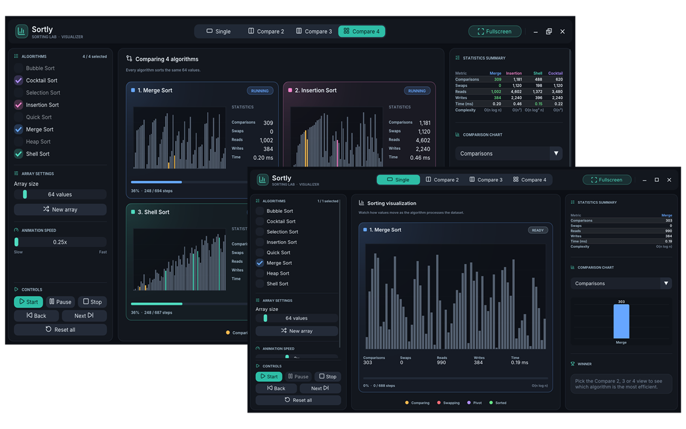

  <picture>
    
  </picture>
  

    <strong>Sorting Algorithm Visualizer built with C++</strong>
  

  

    Cross-platform • Precomputed visualization • Minimal UI • Educational & interactive
  

   

## Overview

**Sortly** is a modular **C++** sorting algorithm visualizer based on a precomputed step-by-step execution model.

It generates all intermediate states of sorting algorithms in advance and replays them through an interactive UI, enabling smooth visualization, comparison, and analysis of different techniques.

Built with **GLFW**, **OpenGL**, **Dear ImGui** and **ImPlot**, it focuses on clarity, extensibility, and ease of experimentation with sorting algorithms.

> [!NOTE]
> This project is currently under active development. The application is reasonably stable at this stage, but future releases may introduce significant changes.

  

## License

This project is licensed under the **MIT License**. 
See the [LICENSE](LICENSE) file for more information.

## Notices

Sortly bundles the following fonts in [`assets/fonts/`](assets/fonts). The license text of each one is shipped next to the fonts, in [`assets/fonts/licenses/`](assets/fonts/licenses).

| Component        | Files                                     | License                          | License file                                                                   |
| ---------------- | ----------------------------------------- | -------------------------------- | ------------------------------------------------------------------------------ |
| Inter            | `Inter-Regular.ttf`, `Inter-SemiBold.ttf` | SIL Open Font License 1.1        | [`Inter-license.txt`](assets/fonts/licenses/Inter-license.txt)                 |
| JetBrains Mono   | `JetBrainsMono-Medium.ttf`                | SIL Open Font License 1.1        | [`JetBrainsMono-OFL.txt.txt`](assets/fonts/licenses/JetBrainsMono-OFL.txt.txt) |
| Lucide icon font | `lucide.ttf`                              | ISC (portions MIT, from Feather) | [`Lucide-LICENSE.txt`](assets/fonts/licenses/Lucide-LICENSE.txt)               |
