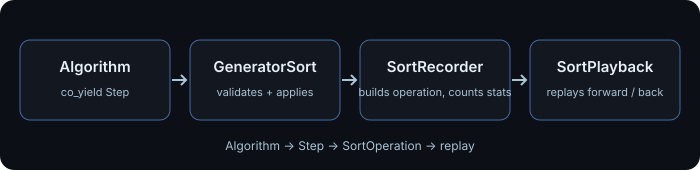
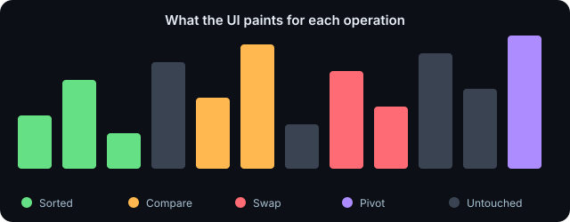
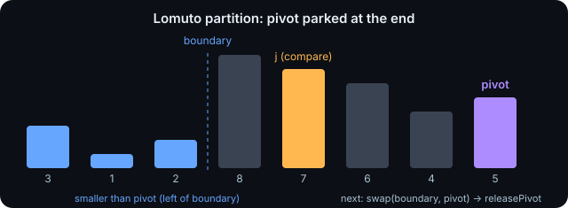

# Adding a sorting algorithm to Sortly

This guide explains how `libs/sorting` turns an algorithm into something the UI can animate, and
gives a checklist to add a new one in about ten minutes.

- [Adding a sorting algorithm to Sortly](#adding-a-sorting-algorithm-to-sortly)
  - [1. How it works](#1-how-it-works)
  - [2. Folder map](#2-folder-map)
  - [3. The Step vocabulary](#3-the-step-vocabulary)
  - [4. Golden rules](#4-golden-rules)
  - [5. Step by step: adding Gnome Sort](#5-step-by-step-adding-gnome-sort)
    - [5.1 Create the header](#51-create-the-header)
    - [5.2 Write the algorithm](#52-write-the-algorithm)
    - [5.3 Add the enumerator](#53-add-the-enumerator)
    - [5.4 Register it](#54-register-it)
    - [5.5 Build and run](#55-build-and-run)
  - [6. The pivot](#6-the-pivot)
    - [What the library does for you](#what-the-library-does-for-you)
    - [What you must do](#what-you-must-do)
    - [Choosing a pivot (design notes)](#choosing-a-pivot-design-notes)
    - [Showing the pivot in the UI](#showing-the-pivot-in-the-ui)
  - [7. Auxiliary buffer and Overwrite](#7-auxiliary-buffer-and-overwrite)
  - [8. Statistics and fair comparison](#8-statistics-and-fair-comparison)
  - [9. Testing](#9-testing)
  - [10. Troubleshooting](#10-troubleshooting)
  - [11. Documentation image templates](#11-documentation-image-templates)
    - [Template A: image left, text right](#template-a-image-left-text-right)
    - [Template B: text left, image right](#template-b-text-left-image-right)
    - [Template C: full-width figure with caption](#template-c-full-width-figure-with-caption)
    - [Template D: before / after](#template-d-before--after)
    - [Suggested images for a new algorithm](#suggested-images-for-a-new-algorithm)

## 1. How it works

<table>
<tr>
<td width="48%" valign="top">



</td>
<td valign="top">

**Precomputed visualization.** The algorithm never runs while the animation plays.

1. The algorithm is a coroutine that *describes* what it wants to do (`co_yield Step::swap(i, j)`).
2. `GeneratorSort` checks the indices and performs the step through `SortRecorder`, which edits
   the working buffer, updates the statistics and returns a `SortOperation`.
3. `SortSession` collects all operations (time-budgeted, so the UI never freezes).
4. `SortPlayback` replays them over its own copy of the data, forward **and backward**.

Because every operation stores the values it touched, undo needs no re-simulation.

</td>
</tr>
</table>

## 2. Folder map

```text
libs/sorting/
├── CMakeLists.txt                  every src/**/*.cpp is built automatically
├── docs/                           this guide + images
├── include/Sortly/Sorting/         PUBLIC API (what the apps include)
│   ├── Sorting.hpp                 umbrella header
│   ├── SortSession.hpp
│   ├── Algorithms/                 SortAlgorithm (interface), SortAlgorithmFactory (registry API)
│   ├── Data/                       DataSet, DataSetBuilder, DataSetConfig, SeedProvider
│   └── Operations/                 SortOperation, SortRecorder, SortStatistics, SortPlayback
├── src/                            PRIVATE implementation
│   ├── SortSession.cpp
│   ├── Algorithms/
│   │   ├── Core/                   Step, StepGenerator, GeneratorSort  (the authoring toolkit)
│   │   ├── <Name>Sort.hpp/.cpp     one pair per algorithm
│   │   └── SortAlgorithmFactory.cpp   the registry
│   ├── Data/
│   └── Operations/
└── tests/                          gtest; algorithms are tested automatically through the registry
```

Rule of thumb: **algorithms live in `src/Algorithms`, never in `include/`.** Apps reach them only
through `SortAlgorithmFactory`.

## 3. The Step vocabulary

<table>
<tr>
<td width="48%" valign="top">



</td>
<td valign="top">

An algorithm can only yield these steps. Anything else must be plain C++ bookkeeping
(loop counters, indices, a stack).

| Step | Changes data | Painted as |
| ---- | ------------ | ---------- |
| `Step::compare(i, j)` | no | amber |
| `Step::compareAux(i, j)` | no | amber |
| `Step::swap(i, j)` | yes | red |
| `Step::overwrite(i, v)` | yes | red |
| `Step::pivot(i)` | no | violet |
| `Step::releasePivot()` | no | clears violet |

`Sorted` is **not** a step: `GeneratorSort` emits it for you when `run()` ends.

</td>
</tr>
</table>

## 4. Golden rules

1. **Change `m_Data` only through yielded steps.** Reading it is free; writing it directly makes the
   recorded operations disagree with reality and breaks replay.
2. **Yield a `compare` before every decision between two elements.** Otherwise the statistics
   undercount and the algorithm looks faster than it is (see [section 8](#8-statistics-and-fair-comparison)).
3. **After a `co_yield` returns, the step has already been applied.** `m_Data` is up to date.
4. **Never emit `Sorted` yourself.** It is automatic, exactly once, also for empty and one-element input.
5. **Handle `n == 0` and `n == 1`.** `size_t` underflow (`n - 1` when `n == 0`) is the classic bug.
6. **Keep indices in range.** A bad index throws `std::out_of_range`; the session reports it as
   `ComputeError::AlgorithmThrew` and the card shows an error instead of crashing.
7. **No recursion across yields.** A coroutine cannot cheaply call itself: use an explicit stack
   (see `QuickSort.cpp`).

## 5. Step by step: adding Gnome Sort

### 5.1 Create the header

`src/Algorithms/GnomeSort.hpp`

```cpp
#pragma once

#include "Algorithms/Core/GeneratorSort.hpp"

namespace Sortly {

// Private to the library: users create it through SortAlgorithmFactory.
class GnomeSort final : public GeneratorSortOf<GnomeSort>
{
public:
    static constexpr AlgorithmMeta kMeta{
        "Gnome Sort",
        "O(n²)",
        "Moves forward while ordered, steps back after every swap."
    };

protected:
    StepGenerator run() override;
};

} // namespace Sortly
```

`kMeta` is the single source of truth for the name, complexity and description. Keep the
description to one sentence and write the complexity as the **average case**.

### 5.2 Write the algorithm

`src/Algorithms/GnomeSort.cpp`

```cpp
#include "GnomeSort.hpp"

namespace Sortly {

StepGenerator GnomeSort::run()
{
    std::size_t i = 1;
    while (i < m_Data.size())
    {
        co_yield Step::compare(i - 1, i);
        if (m_Data[i - 1] <= m_Data[i])
        {
            ++i;
        }
        else
        {
            co_yield Step::swap(i - 1, i);
            i = (i > 1) ? i - 1 : i + 1;
        }
    }
}

} // namespace Sortly
```

### 5.3 Add the enumerator

`include/Sortly/Sorting/Algorithms/SortAlgorithmFactory.hpp`: add it **before `Count`**.

```cpp
    ShellSort,
    GnomeSort,   // new

    Count
};
```

### 5.4 Register it

`src/Algorithms/SortAlgorithmFactory.cpp`: add the include and **one line**, in enum order.

```cpp
#include "GnomeSort.hpp"
...
    entry<GnomeSort>(SortAlgorithmType::GnomeSort),
```

If you forget the line, or put it out of order, the build stops with
`registry must list every SortAlgorithmType`.

### 5.5 Build and run

Re-run CMake (the source glob picks the new `.cpp`). The algorithm now shows up in the UI list,
the compare views, the statistics table and the tests, with no further edits.

## 6. The pivot

<table>
<tr>
<td width="48%" valign="top">



</td>
<td valign="top">

The pivot is a **mark on one element**, so the UI can keep it highlighted while the
algorithm compares other elements against it.

**Protocol**

1. Put the pivot where it will stay during the partition (QuickSort parks it at `high`).
2. `co_yield Step::pivot(index)`: marks it (violet).
3. Partition. `Pivot` does not change the data.
4. When the pivot reaches its final position: `co_yield Step::releasePivot()`.

</td>
</tr>
</table>

### What the library does for you

| Behavior | Detail |
| -------- | ------ |
| Value capture | The recorder receives the pivot index and reads the value from `GeneratorSort` (the buffer); you only pass the index. |
| Follows swaps | `SortPlayback::getPivotIndex()` tracks the *element*: if `swap(boundary, high)` moves it, the index moves too. |
| Undo | Stepping backward restores the previous pivot exactly. |
| Stop / reload | `stop()` and `load()` clear the pivot. |
| Validation | `load()` rejects a pivot index outside the data (`-1` means "none"). |
| Statistics | Pivot steps only add to `operationCount`; they are not comparisons. |

### What you must do

- **Mark after the pivot is in place.** Median-of-three swaps happen *before* `Step::pivot`, so the
  mark never points at an element that is about to move for reasons unrelated to the partition.
- **Release when done.** A stale mark would stay highlighted through the next range. If the run ends
  without releasing it, the final `Sorted` state hides it, but release anyway.
- **Only one pivot at a time.** `Step::pivot` replaces the previous mark. Algorithms with several
  pivots (dual-pivot quicksort) should mark the one currently being compared against.
- **Compare against the pivot with `compare(j, pivotIndex)`** so the comparison is counted.
- **Read the pivot value once** into a local (`const int pivot = m_Data[high];`) if the partition
  loop uses it a lot; it cannot change while it is parked.

### Choosing a pivot (design notes)

| Strategy | Cost | Effect |
| -------- | ---- | ------ |
| Last element | free | O(n²) on sorted or reversed input |
| Median of three (used here) | 3 compares per range, yielded | Avoids the sorted-input worst case |
| Random | needs a seed | Not reproducible unless seeded; avoid in a visualizer |

Every compare used to *choose* the pivot must be yielded too, just like the partition compares.

### Showing the pivot in the UI

The library exposes `playback.getPivotIndex()`; painting it is a UI job (three small edits):

```cpp
// ArrayPlot.hpp, in ArrayHighlight
int pivot = -1; // Persistent pivot element, -1 when none.

// RunCard.cpp, next to highlight.operation = ...
highlight.pivot = playback.getPivotIndex();

// ArrayPlot.cpp, after the base PlotBars and before the "Active" bars
if (highlight.pivot >= 0 && !highlight.sorted &&
    static_cast<std::size_t>(highlight.pivot) < data.size())
{
    const int x = highlight.pivot;
    const int y = data[static_cast<std::size_t>(x)];
    ImPlot::PlotBars("Pivot", &x, &y, 1, 0.78,
                     ImPlotSpec{ ImPlotProp_FillColor, operationColor(SortOperation::Type::Pivot) });
}
```

## 7. Auxiliary buffer and Overwrite

<table>
<tr>
<td valign="top">

Merge-style algorithms do not swap: they **write** values taken from somewhere else.

- `m_Aux` is a scratch buffer, the same size as `m_Data`, **initially a copy of it**.
- Fill it yourself with plain C++ (`std::copy`); this is not a step.
- Read from it with `Step::compareAux(i, j)`.
- Write results back with `Step::overwrite(index, value)`. The recorder stores the *old* value
  too, which is what makes undo O(1).

| Use | When |
| --- | ---- |
| `swap` | The two elements simply exchange places. |
| `overwrite` | A slot receives a value that comes from elsewhere. |

Copies into `m_Aux` are not yielded, so they are **not** counted as reads/writes. State that in
a comment (see `MergeSort.cpp`).

</td>
<td width="40%" valign="top">

<!-- Image slot (see section 11): images/merge-aux.png -->

*Image slot: `images/merge-aux.png`, two runs merging through the auxiliary buffer.*

</td>
</tr>
</table>

## 8. Statistics and fair comparison

The summary panel declares a winner per metric, so every algorithm must count the same way.

| Call | comparisons | swaps | reads | writes |
| ---- | ----------- | ----- | ----- | ------ |
| `compare` / `compareAux` | +1 | | +2 | |
| `swap` | | +1 | +2 | +2 |
| `overwrite` | | | +1 | +1 |
| `pivot`, `releasePivot`, `sorted` | | | | |

- **Compare, then act.** `compare` followed by `swap` counts *both*. Replacing a compare with a
  swap hides one comparison. Bubble and Cocktail sort did exactly that before this refactor.
- **Be adaptive honestly.** Early exits (a pass without swaps) are fine, but they change the
  numbers, so mention them in the description.
- Compute time (`computeTimeMs`) measures only the algorithm's stepping, never playback speed.

## 9. Testing

`tests/Algorithms_test.cpp` runs **every registered algorithm** (through `getAvailableAlgorithms()`)
on empty, single, sorted, reversed, duplicate and mixed inputs and checks that it:

- sorts and keeps the same elements,
- emits exactly one terminal `Sorted`,
- can be replayed forward and backward to the original data,
- reports statistics that match its operations,
- can be reloaded and reused.

A new algorithm is covered automatically. Add a dedicated test only for behavior that is specific
to it (for example, an exact comparison count on a known input, as in `AlgorithmStatistics_test.cpp`).

## 10. Troubleshooting

| Symptom | Likely cause |
| ------- | ------------ |
| Build error `registry must list every SortAlgorithmType` | Missing or misordered `entry<...>` line, or the enumerator is after `Count` |
| Link error: undefined `run()` | New `.cpp` not picked up: re-run CMake |
| Result is not sorted | `m_Data` modified directly instead of through a step |
| Replay backward shows a different array | Same cause: unrecorded writes |
| Card shows "The algorithm failed unexpectedly." | A yielded index is out of range (check the log for `step index`) |
| Crash or hang on empty input | `n - 1` underflow with `size_t`; add an early `co_return` |
| Statistics lower than expected | A decision was made without yielding a `compare` |
| Pivot stays highlighted across ranges | Missing `Step::releasePivot()` |
| Animation looks stuck | Too many unyielded loops: every visible change must be a step |

## 11. Documentation image templates

Images live in `docs/images/`. Prefer **SVG** for diagrams (they stay sharp and diff cleanly) and
PNG for screenshots. Use the dark UI palette so images match the app:
`#0C0F15` background, amber `#FFB84F` compare, red `#FF6B75` swap, violet `#AD8CFF` pivot,
green `#66E085` sorted, blue `#66A6FF` accent.

Markdown inside `<td>` renders only if there is a **blank line** after `<td>` and before `</td>`.
Keep to these HTML elements (the repository's `.markdownlint.yaml` allows them): `table`, `tr`,
`td`, `th`, `img`, `br`, `a`, `div`, `p`.

### Template A: image left, text right

```html
<table>
<tr>
<td width="48%" valign="top">


</td>
<td valign="top">

Explanation in Markdown.

</td>
</tr>
</table>
```

### Template B: text left, image right

```html
<table>
<tr>
<td valign="top">

Explanation in Markdown.

</td>
<td width="48%" valign="top">


</td>
</tr>
</table>
```

### Template C: full-width figure with caption

```html
<div align="center">
  
  <br>
  <sub>Figure 1. One-sentence caption.</sub>
</div>
```

### Template D: before / after

```html
<table>
<tr>
<th width="50%">Before</th>
<th width="50%">After</th>
</tr>
<tr>
<td></td>
<td></td>
</tr>
</table>
```

### Suggested images for a new algorithm

| File | Size | Shows |
| ---- | ---- | ----- |
| `images/<name>-trace.svg` | 640 x 250 | 8 to 12 bars at one key moment, with the operation colors above |
| `images/<name>-steps.png` | 1280 x 500 | 3 frames (start, middle, end) of the real app, side by side |
| `images/<name>-compare.png` | 1280 x 720 | The compare view against a similar algorithm |

Always give `alt` text that describes what is shown, not the file name.
